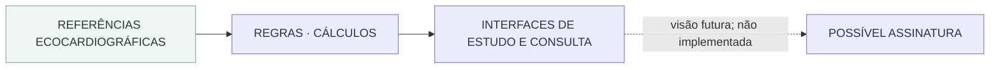

# EcoMaster Pro

**Referência rápida, cálculos e raciocínio estruturado em ecocardiografia.**

> **English:** Interactive echocardiography learning platform for structured cardiac-imaging education and clinical reasoning.

[**Abrir demonstração**](https://joyceradis.github.io/EcoMasterPro/)

## Identidade e limites do projeto

**Categoria:** produto independente de educação e referência em ecocardiografia, com **possível modelo comercial por assinatura no futuro**.

O **EcoMaster Pro** não é uma ferramenta de atendimento ecocardiográfico pessoal da autora. A proposta é construir um produto que possa oferecer conteúdo organizado, interpretação contextual e funcionalidades especializadas a profissionais ou estudantes. O público-alvo, a precificação, as licenças, a autenticação de assinantes e a arquitetura comercial ainda devem ser definidos e validados.

Ele **não** pertence automaticamente à Radis nem ao mecanismo de tentativas do Medical Residency Programs. Eventual referência cruzada entre produtos deve decorrer de uma necessidade real, não de proximidade temática.

**Estado:** demonstração educacional e experimentos de interface; assinatura comercial **não implementada**.

**Rastreabilidade:** [histórico do README](https://github.com/joyceradis/EcoMasterPro/commits/main/README.md) · [PRs](https://github.com/joyceradis/EcoMasterPro/pulls?q=is%3Apr).

## Encontrar a implementação

| Necessidade | Onde consultar |
|---|---|
| Primeira interface e regras frontend | [`index.html`](index.html) · [`script.js`](script.js) · [`styles.css`](styles.css) |
| Experimento de interface alternativo | [`index2.html`](index2.html) · [`script-2.js`](script-2.js) · [`styles-v2.css`](styles-v2.css) |
| Escopo e desenvolvimento do produto | [Objetivo](#objetivo) · [Direção do produto](#direção-do-produto) |

**Identidade:** produto educacional de ecocardiografia, com possibilidade futura de modelo comercial por assinatura. **Não** assumir integração com Radis, atendimento próprio ou assinatura já disponível.

### Diagrama de orientação · Produto educacional de ecocardiografia



**Leitura:** setas contínuas representam o fluxo conceitual dentro do produto; setas pontilhadas indicam relação entre sistemas ou possibilidade futura, **não integração implementada**.

## O que este repositório demonstra

| Competência | Evidência no projeto |
| --- | --- |
| Modelagem de conhecimento médico | referências organizadas por domínio, população, contexto e armadilhas interpretativas |
| Estruturação de conteúdo clínico | módulos para adulto, pediatria, neonatal e fetal representados como dados consumidos pela interface |
| Lógica frontend | JavaScript para filtros, navegação, cálculos e apresentação contextual |
| Clinical UX | desenho voltado a consulta rápida sem converter número isolado em conclusão diagnóstica |
| Product thinking | transformação de conhecimento disperso em ferramenta interativa com regras explícitas de uso |

**Portfolio signal:** medical knowledge modeling · JavaScript · clinical education · structured data · clinical UX · product design

O EcoMaster Pro é uma aplicação web educacional criada para organizar parâmetros ecocardiográficos, cálculos derivados e etapas de interpretação em uma interface de consulta rápida. O projeto nasce da interseção entre medicina, educação e design de ferramentas clínicas.

## Objetivo

Ecocardiografia exige integrar medidas, indexações, contexto hemodinâmico e critérios que não devem ser interpretados isoladamente. O EcoMaster organiza esse processo em um fluxo visual que reduz a necessidade de alternar entre múltiplas tabelas e referências.

```text
PACIENTE + CONTEXTO
        ↓
MEDIDAS ECOCARDIOGRÁFICAS
        ↓
CÁLCULOS / INDEXAÇÕES
        ↓
FAIXAS DE REFERÊNCIA
        ↓
INTERPRETAÇÃO CONTEXTUAL
```

## Capacidades atuais

- referência rápida de medidas e valores;
- cálculos derivados e indexados;
- avaliação de massa e geometria ventricular;
- apoio à leitura de função sistólica e diastólica;
- parâmetros de ventrículo direito e estimativas hemodinâmicas;
- organização de conteúdo para ecocardiografia adulta, pediátrica, neonatal e fetal;
- interface responsiva para consulta durante estudo ou revisão.

## Princípios

**Cálculo não é diagnóstico.** O resultado numérico é uma camada do raciocínio, não sua conclusão.

**Valor de referência não é contexto clínico.** Ritmo, idade, superfície corporal, valvopatias, qualidade da janela e condições hemodinâmicas podem alterar a interpretação.

**Dados ausentes permanecem ausentes.** A interface não deve converter campo não preenchido em normalidade presumida.

**Ferramenta educacional, não laudo autônomo.** O produto organiza informação e raciocínio; não substitui aquisição adequada de imagens, interpretação médica ou diretrizes vigentes.

## Tecnologia

Projeto client-side, sem backend obrigatório:

- HTML5;
- CSS3;
- JavaScript;
- execução direta em navegador;
- arquitetura adequada para publicação estática.

## Estrutura principal

```text
EcoMasterPro/
├── index.html
├── index2.html
├── script.js
├── script-2.js
├── styles.css
├── styles-v2.css
├── README.md
└── LICENSE
```

A existência de versões paralelas preserva experimentação de interface sem apagar a evolução anterior do projeto.

## Execução local

```bash
python3 -m http.server 8000
```

Depois acesse `http://localhost:8000`.

## Direção do produto

O roadmap conceitual inclui maior rastreabilidade das referências, versionamento de critérios, expansão das calculadoras, organização por cenário clínico e testes automatizados para fórmulas e regras interpretativas.

## Autoria

Projeto idealizado e desenvolvido por **Dra. Joyce Radis**, médica, como ferramenta de estudo e exploração de interfaces clínicas orientadas por evidência.

## Licença

Consulte o arquivo [LICENSE](LICENSE).
